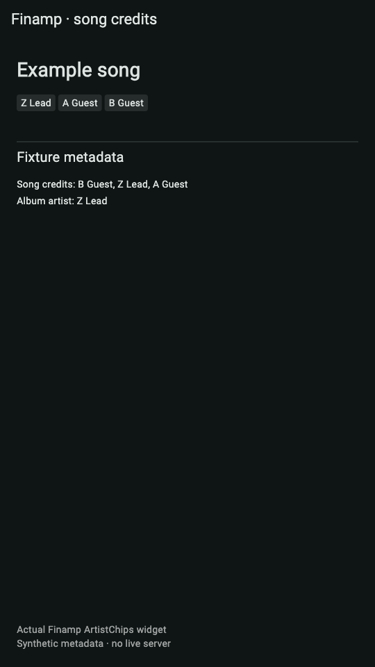
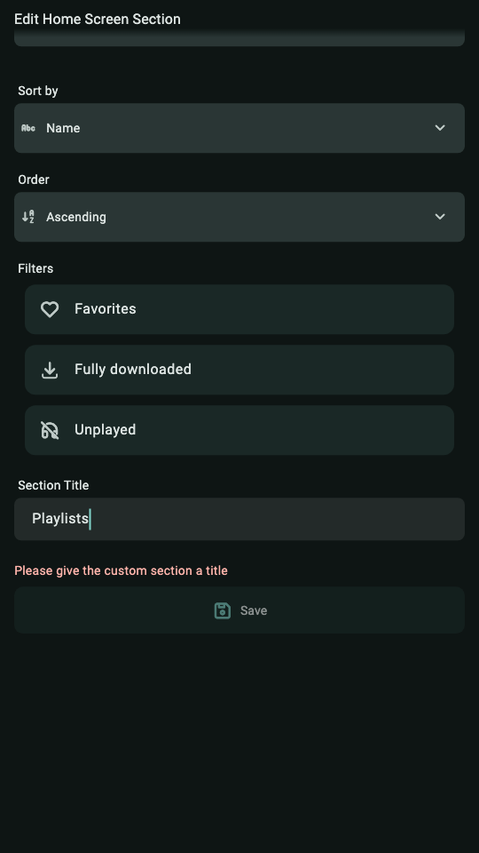
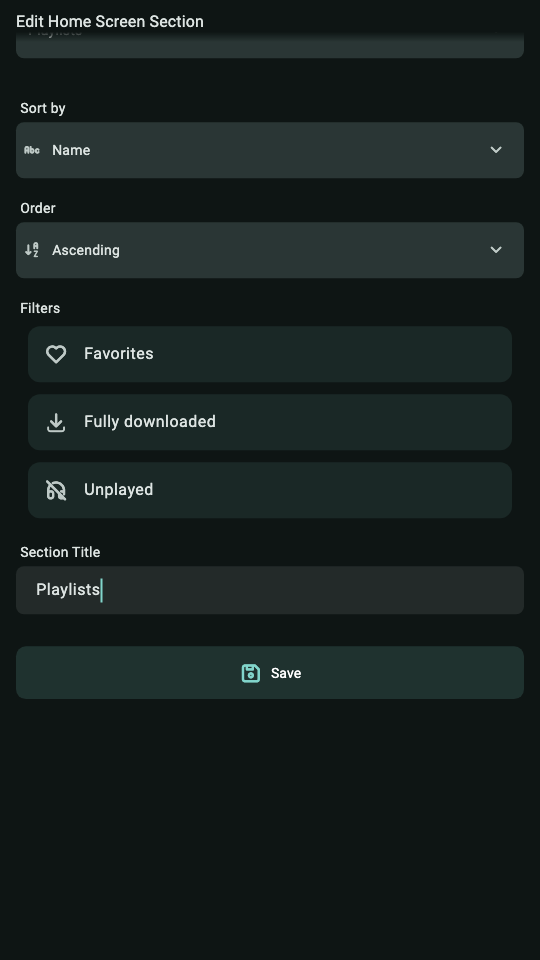
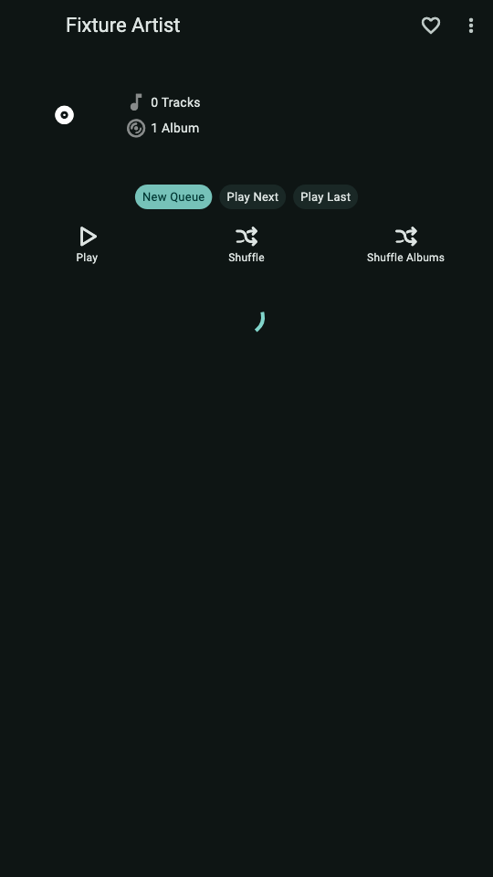
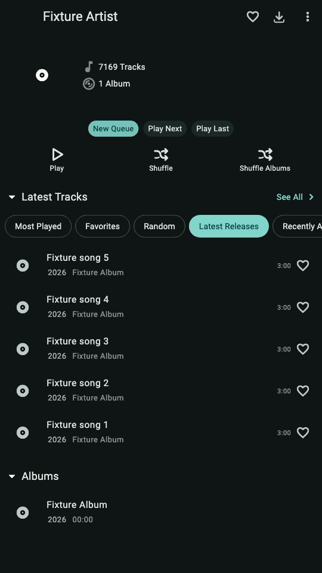

# Finamp contribution evidence — 2026-10-28

These are captures of **actual Finamp widgets with synthetic fixture data**,
rendered by Flutter widget tests. They are not Android-device screenshots, a
live Jellyfin session or a measured network/latency benchmark. A fixture theme
and scaffold are used. No personal account, server or library is included.

Before: upstream `redesign`, `b72ba46a45eb45836516f23e3df989c89c693c88`.
After: combined source `ec109989ace6143377567a1ec71664ec6863dcc3`, containing
the independent changes from [#1830](https://github.com/finamp-app/finamp/pull/1830),
[#1831](https://github.com/finamp-app/finamp/pull/1831) and
[#1832](https://github.com/finamp-app/finamp/pull/1832). The evidence files are kept
on their own branch and are not added to those upstream PRs.

| Case | Before | After |
| --- | --- | --- |
| Song artist credit order |  |  |
| Custom-section title |  |  |
| Artist page with a pending large response |  |  |

The artist-credit images embed the real `ArtistChips` in a small fixture
scaffold. The title images capture `HomeScreenSectionConfigurationMenu` after
typing `Playlists`, hiding the test keyboard and scrolling the same distance.
The artist-page images capture the real `ArtistScreenContent`.

The additional [setting capture](artist-order-settings-after.png) shows the real
`TrackArtistOrderSelector` with all four menu entries. This feature is selectable,
including the old alphabetical display; metadata is not rewritten.

## Performance-fixture conditions

Both revisions receive the same fake service boundary. Album responses and
bounded song/count requests complete; unbounded song requests deliberately stay
pending. Capture follows the same fixed Flutter pump durations, not a real-time
server measurement. `TotalRecordCount=7169` is fixture metadata and five preview
songs are returned. This shows independence from an outstanding large query;
it does not establish real-server latency, counts, playback or download behavior.

Before, the screen issues `Limit=5`, `Limit=null`, `Limit=null` song requests and
remains waiting. After, song display uses `Limit=5`, a `Limit=1` count request,
and `Limit=5`; the fixture asserts that no unbounded request was made.

The separate regression in `test/artist_screen_loading_test.dart` measures
synthetic serialized preview responses: 2,148,827 bytes before, 2,092 after.
Those numbers do not come from these PNGs or from a live Jellyfin server.

## Reproduce

Flutter 3.47.8 / Dart 3.13.7, macOS ARM64. The before harness passes three
asserted captures; the after/settings harness passes four. Full combined app
tests, excluding these publication harnesses, pass all 78 tests.
An isolated replay produced all seven PNGs **byte for byte identical**; image
dimensions and SHA-256 hashes are recorded in `provenance.json`.

From a clone containing the pinned commits, with Flutter and Python 3 available:

```sh
FLUTTER=/absolute/path/to/flutter/bin/flutter \
  bash contribution-evidence/2026-10-28/reproduce.sh /absolute/path/to/captures
```

The script creates two isolated local clones and prints their temporary parent
path. It does not switch or reset the current checkout. Output goldens are
written to the requested directory. The helper font directory can be overridden
with `FLUTTER_FONT_DIR`.

After changing revisions, regenerate localizations before `flutter test --no-pub`.
The generated localization files are ignored: reusing them from another branch
can leave getters missing even though the checked-out `.arb` source is correct.
The harness explicitly loads Roboto and the declared icon fonts so screenshots
show readable text/icons rather than test-font blocks.

The combined debug APK was also installed as an update to the earlier fixture
preview and cold-started to the welcome screen on the disposable Android 15
ARM64 emulator. Android UIAutomator exposes Flutter labels in `content-desc` as
well as `text`; startup assertions must read both. This startup smoke check does
not cover Jellyfin authentication, playback or a physical/OEM device.

Source patches and builds remain MPL-2.0 derivatives of Finamp. These source
changes have no declared Morphe/original-APK compatibility.
