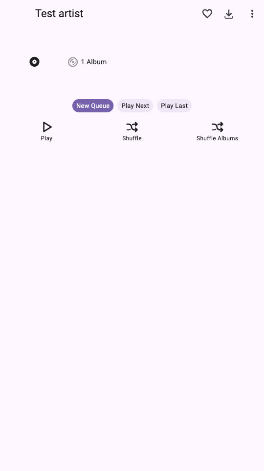
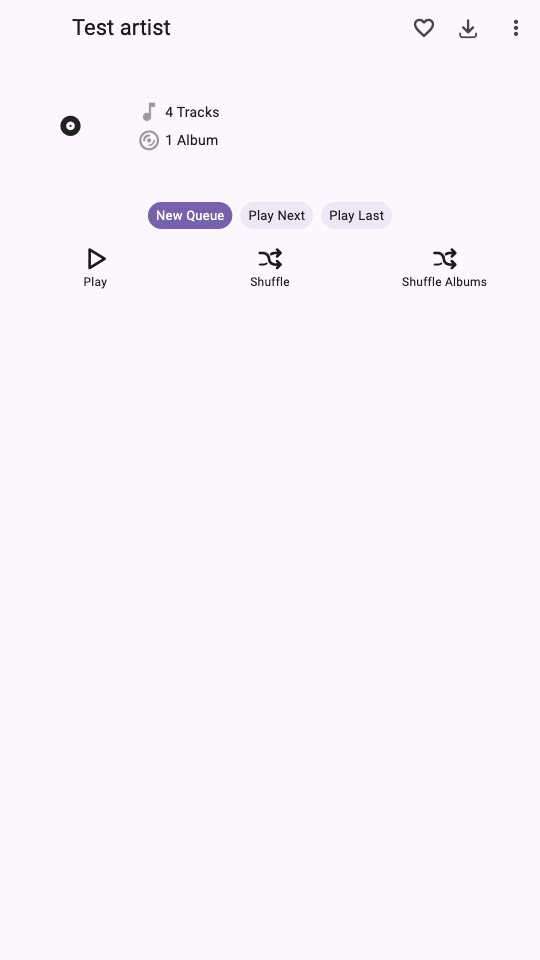

# Artist-page review evidence

For [Finamp PR #1832](https://github.com/finamp-app/finamp/pull/1832), comparing
the reviewed head `8d6b4b6868481175339137a32d057055e103289e` with
`3f463b0e697f11aeebc37e1a6b614cde391b7f7f`.
This evidence lives on its own branch; it is not additional app code in the PR.

## Visible behavior

These capture the actual `ArtistScreenContent` with identical fake service
boundaries: one album containing three credited tracks and one guest track.
The preview is disabled in both revisions. Album queries complete while the
bounded count response is held pending. Flutter 3.47.8 / Dart 3.13.7 on macOS ARM64.

| Reviewed head: missing counter row | Updated: stable loading row | Updated: completed count |
| --- | --- | --- |
|  |  |  |

The regression asserts that the album row's position stays unchanged when
loading becomes a number or error. A valid zero remains `0 Tracks`.
The loading assertion fails against the reviewed head, then passes after the fix.
The images are widget renders, not device screenshots or a latency benchmark.

## Actual Jellyfin API behavior

[Recorded responses and query parameters](jellyfin-api-probe.json) contain
**12 executed checks on a real isolated Jellyfin 12.3.0 server**.
Six one-second silent FLACs in [fixtures/](fixtures/) carry synthetic metadata;
five are in `Probe main`, one is in `Probe other`.
No personal account or media was used.

In the main library, target artist credits form these sets:

| Meaning | Count | Query behavior |
| --- | ---: | --- |
| Both track and album artist | 2 | Included once in the union |
| Album artist only | 1 | Included by `ArtistIds` as well as `AlbumArtistIds` |
| Track artist only / guest | 1 | Included by `ArtistIds` and `ContributingArtistIds` |
| Distinct union | 4 | `ArtistIds`; still `TotalRecordCount=4` with `Limit=1` |
| All album-artist credits | 3 | `AlbumArtistIds` |
| All track-artist credits | 3 | Fixture metadata; **not** what `ArtistIds` means |

Genre filtering gives three union tracks for Rock. Favoriting `Guest Only`
gives one favorite union track. Jazz plus favorites gives a real zero.
Removing the library scope gives five union tracks, proving the second library
is excluded by `ParentId`. Combining album and union filters returns the three
album-credit tracks; combining album and contributing filters returns zero.
The existing download query's `Filters=Artist=...` parameter does not narrow
the four `ArtistIds` tracks on this server.

**Observed server edge case:** a nonexistent but valid UUID in `ArtistIds`
does not produce zero on 12.3.0: the filter is ignored and all five tracks in
the scoped library are returned. The app's count query uses the ID of its
loaded artist. The PR does not introduce a workaround for stale/deleted artist
IDs; the old full enumeration is subject to the same server behavior.

Primary-source cross-checks:

- [Jellyfin 10.10.7 SQL predicates](https://github.com/jellyfin/jellyfin/blob/v10.10.7/Emby.Server.Implementations/Data/SqliteItemRepository.cs#L3562-L3610):
  artist IDs cover both stored credit kinds, album IDs restrict the album-credit
  kind, contributing IDs exclude album credits.
- [Jellyfin 12.3 query translation](https://github.com/jellyfin/jellyfin/blob/v12.3/Jellyfin.Server.Implementations/Item/BaseItemRepository.TranslateQuery.cs#L617-L645)
  implements the same distinction.

The previous `(total, performing)` result has therefore been replaced by one
explicit union count. No second value is mislabeled as a strict performing count.

## Download inputs

Finamp's existing download backend creates direct album links **and** direct
track links from the `ArtistIds` query. Thus the fixture has **five direct
children** (one album + four tracks), while the warning receives **four distinct
credited tracks**. These are different quantities. Album/track links are not
added together to estimate unique audio files.

The warning awaits the same bounded count provider when pressed early; failure
shows the error and stops the action without an album-only fallback. Removal
controls remain available while counts are unknown. A guest-only artist still
receives its direct track count and warning count. Album downloads retain their
existing child-list fallback. Full playback queries still run on demand.

The warning count is based on artist-credit membership, not file sizes. This
fixture does not establish download totals for inconsistent mixed-album metadata,
or timing/RAM improvements on a real music library. The old offline track
enumeration is reused; unrelated offline filtering behavior is unchanged.

## Reproduce

Run `flutter pub get` and `flutter test` at the updated commit. The suite has
47 passing tests, including six widget regressions added for this review.

For screenshots, copy `artist_review_capture_test.dart` to `test/` at each pinned
revision, then run:

```sh
flutter test test/artist_review_capture_test.dart --update-goldens \
  --dart-define=CAPTURE_STAGE=after \
  --dart-define=CAPTURE_DIR=/absolute/output/directory \
  --dart-define=FONT_DIR=/absolute/flutter/bin/cache/artifacts/material_fonts
```

Use `CAPTURE_STAGE=before` for the reviewed head. Remove the copied test afterward.
The screenshot harness is separate from the 47 app tests. [Provenance](provenance.json)
records image hashes and source revisions.

For an API replay, start a disposable loopback Jellyfin server, add `fixtures/main`
and `fixtures/other` as music libraries named `Probe main` and `Probe other`, scan
them, and mark `Guest Only` as a favorite. Supply the server URL, test user ID and
token privately in `JELLYFIN_URL`, `JELLYFIN_USER_ID`, `JELLYFIN_TOKEN`. Run
`python3 probe_artist_queries.py`. It makes read-only requests and verifies all
12 recorded totals. Live execution was performed on 12.3.0; 10.10.7 was checked
against source, not booted for a live replay.

## Scope

This updates the existing source PR. Older combined preview APKs and Penguin
patch releases are separate artifacts and do not contain this review revision.
No patch release is updated here. Physical-device playback/download acceptance
and real-library performance measurements remain outside this verification.
